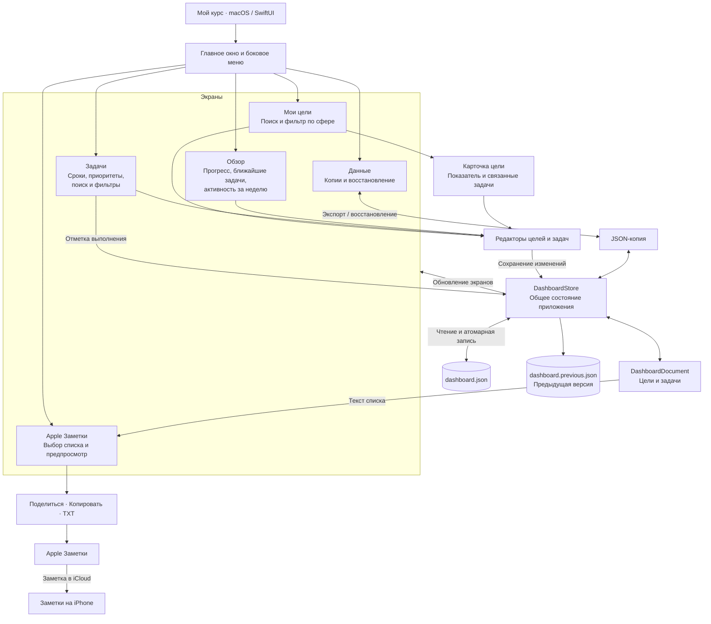

# Схема приложения «Мой курс»

Структурная схема приложения показывает основные экраны, компоненты и потоки данных.
Диаграмма записана в Mermaid, тип `flowchart`, и отображается в Markdown на GitHub.

У цели может быть несколько задач; задача может существовать без цели. Прогресс
цели считается по числовому показателю или доле выполненных задач. При удалении
цели связанные задачи остаются без привязки.

Данные хранятся локально на Mac, в
`~/Library/Application Support/MyDashboard/dashboard.json`. После каждого
изменения приложение сохраняет документ атомарно и сохраняет предыдущую версию
в `dashboard.previous.json`. При восстановлении повреждённого файла или миграции
старого формата оригинал сохраняется в отдельной копии.

Перенос в Apple Заметки односторонний: изменения в заметке не обновляют
приложение. Заметка доступна на iPhone, если сохранена в iCloud и синхронизация
Заметок включена на обоих устройствах с одним Apple Account.

Основные исходные файлы:

- [MyDashboardApp.swift](../Sources/MyDashboard/MyDashboardApp.swift) — запуск и создание общего хранилища.
- [ContentView.swift](../Sources/MyDashboard/ContentView.swift) — навигация, обзор, цели и задачи.
- [Editors.swift](../Sources/MyDashboard/Editors.swift) — редакторы и карточка цели.
- [DashboardStore.swift](../Sources/MyDashboard/DashboardStore.swift) — состояние, сохранение и восстановление.
- [Models.swift](../Sources/MyDashboard/Models.swift) — модели, расчёт прогресса и текстовый экспорт.
- [ExportAndDataViews.swift](../Sources/MyDashboard/ExportAndDataViews.swift) — экраны Apple Заметок и данных.
